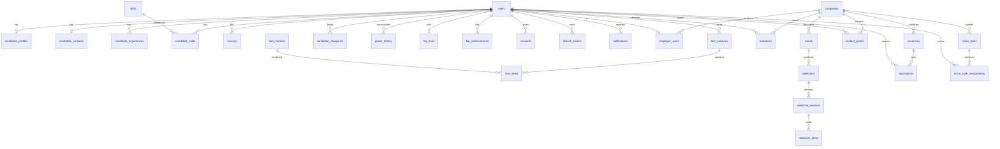
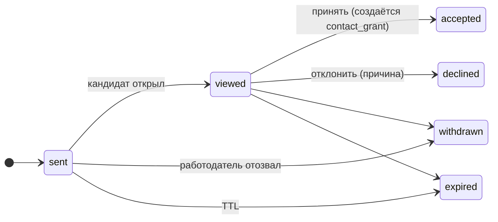
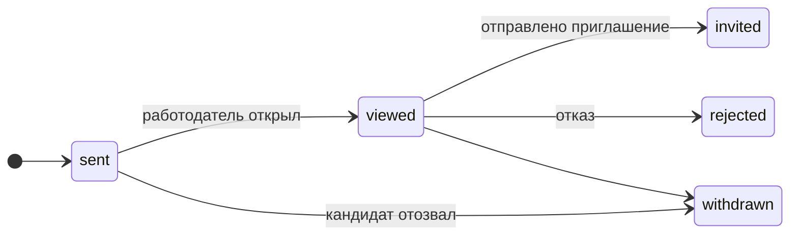
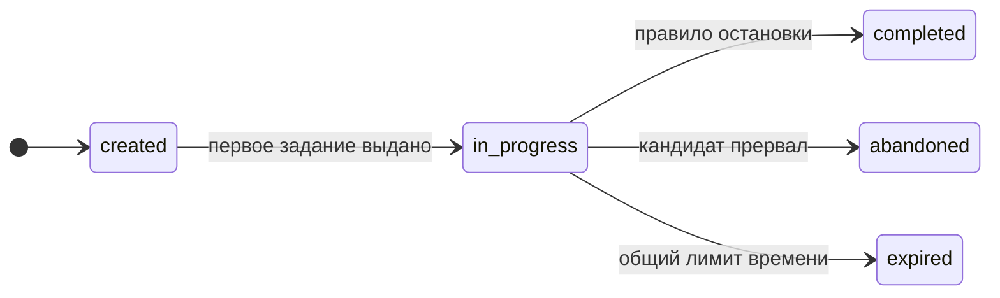

# 02. Модель данных

PostgreSQL 18, схема `public`, UUID-идентификаторы (`gen_random_uuid()`), время `timestamptz` в UTC,
деньги — целые рубли. Миграции goose в `internal/storage/postgres/migrations`, запросы — sqlc.
Перечисления — PostgreSQL `enum`; переходы статусов проверяются в `internal/domain`.

## 1. ERD (основные сущности)

## 2. Перечисления

| Тип | Значения |
|---|---|
| `user_role` | `candidate`, `employer`, `admin` |
| `user_status` | `active`, `blocked`, `deleted` |
| `specialization_code` | `backend`, `frontend`, `data_ml`, `devops`, `qa`, `security`, `common` |
| `grade_code` | `junior`, `middle`, `senior` |
| `grade_status` | `claimed`, `confirmed`, `not_confirmed`, `upgrade_suggested` |
| `candidate_visibility` | `open`, `passive`, `hidden` |
| `work_format` | `office`, `hybrid`, `remote` |
| `skill_source` | `declared`, `resume`, `test_confirmed` |
| `consent_kind` | `processing`, `publication`, `fsp_data` |
| `verification_purpose` | `verify_email`, `reset_password` |
| `test_session_status` | `created`, `in_progress`, `completed`, `abandoned`, `expired` |
| `need_status` | `draft`, `active`, `archived` |
| `invitation_status` | `sent`, `viewed`, `accepted`, `declined`, `withdrawn`, `expired` |
| `decline_reason` | `salary_below`, `not_looking`, `role_mismatch`, `format_mismatch`, `company`, `other` |
| `vacancy_status` | `draft`, `published`, `closed` |
| `application_status` | `sent`, `viewed`, `invited`, `rejected`, `withdrawn` |
| `contact_grant_source` | `invitation_accepted`, `application_sent` |
| `micro_task_status` | `active`, `archived` |
| `micro_task_assignment_status` | `offered`, `accepted`, `submitted`, `reviewed`, `declined`, `expired` |
| `fsp_discipline` | `algorithmic`, `product`, `security`, `robotics`, `uav` |
| `fsp_level` | `regional`, `national`, `international` |
| `fsp_result_kind` | `place`, `rank`, `rating`, `participation` |
| `notification_kind` | `invitation_received`, `invitation_status`, `application_status`, `test_result`, `micro_task_offered`, `system` |

## 3. Таблицы

Обозначения: `pk` — первичный ключ, `fk` — внешний ключ, `!` — NOT NULL, `u` — уникальность.

### 3.1 Пользователи и доступ

**users** — учётные записи.
`id uuid pk` · `email citext ! u` · `email_verified_at` · `password_hash text` (NULL при входе только через ФСП ID) ·
`role user_role !` · `status user_status ! = active` · `created_at !` · `updated_at !` · `last_login_at`.

**email_verifications** — коды подтверждения и сброса.
`id uuid pk` · `user_id fk !` · `purpose verification_purpose !` · `code_hash text !` · `expires_at !` · `consumed_at` ·
`attempts int ! = 0` · `created_at !`. Индекс `(user_id, purpose, created_at desc)`.

**refresh_tokens** — ротация refresh-токенов.
`id uuid pk` · `user_id fk !` · `token_hash text ! u` · `expires_at !` · `revoked_at` · `replaced_by uuid` · `user_agent text` · `ip inet` · `created_at !`.

**consents** — согласия 152-ФЗ.
`id uuid pk` · `user_id fk !` · `kind consent_kind !` · `version text !` (версия текста) · `accepted_at !` · `ip inet` · `user_agent text` · `withdrawn_at`.
Действующее согласие — запись с `withdrawn_at IS NULL`, последняя по `accepted_at`.

**audit_log** — журнал действий с ПДн и статусами.
`id bigserial pk` · `actor_user_id uuid` · `action text !` (`contacts.view`, `privacy.update`, `invitation.accept`, …) ·
`object_type text !` · `object_id uuid` · `details jsonb` · `ip inet` · `created_at !`. Индексы по `(object_type, object_id)` и `created_at`.

### 3.2 Кандидат

**candidate_profiles** — профиль без контактов.
`user_id uuid pk fk` · `first_name text !` · `last_name text !` · `middle_name text` · `city text` ·
`work_formats work_format[] ! = '{}'` · `relocation bool ! = false` · `salary_min int` (порог) · `salary_expected int` ·
`visibility candidate_visibility ! = open` · `headline text` · `about text` · `experience_years numeric(4,1)` ·
`primary_specialization specialization_code` · `links jsonb ! = '{}'` (github, site, …) · `resume_pdf_path text` ·
`created_at !` · `updated_at !`. Проверки: `salary_min > 0`, `salary_expected > 0`.

**candidate_contacts** — контакты, выдаются только по гранту.
`user_id uuid pk fk` · `phone text` · `telegram text` · `email text` (публичный e-mail, по умолчанию логин) · `other jsonb ! = '{}'` · `updated_at !`.

**privacy_settings** — что видно работодателю до раскрытия контактов.
`user_id uuid pk fk` · `show_full_name bool ! = true` · `show_experience bool ! = true` · `show_fsp bool ! = true` ·
`show_salary_expected bool ! = true` · `show_city bool ! = true` · `updated_at !`.

**candidate_experiences** — места работы.
`id uuid pk` · `user_id fk !` · `company_name text !` · `position text !` · `specialization specialization_code` ·
`started_on date !` · `ended_on date` · `description text` · `stack text[] ! = '{}'` · `sort_order int ! = 0`.

**candidate_education** — образование.
`id uuid pk` · `user_id fk !` · `institution text !` · `degree text` · `field text` · `graduated_year int`.

**skills** — справочник (сидируется из `skills.yaml`).
`id serial pk` · `code text ! u` · `name text ! u` · `group_code text !` · `specs specialization_code[] !` · `topic text` · `synonyms text[] ! = '{}'`.
Индекс GIN по `synonyms` для поиска.

**candidate_skills** — навыки кандидата.
`user_id fk !` · `skill_id fk !` · `level smallint` (1–5, самооценка) · `source skill_source !` · `confirmed_session_id uuid` ·
`created_at !`. `pk (user_id, skill_id)`.

**resume_uploads** — загрузки PDF и результат разбора.
`id uuid pk` · `user_id fk !` · `file_name text !` · `mime text !` · `size_bytes int !` · `storage_path text !` ·
`parsed_at` · `parse_result jsonb` · `parser text` (`mock-llm`, `openai`, …) · `created_at !`.

### 3.3 Опрос, тест, категория

**surveys** — история анкет.
`id uuid pk` · `user_id fk !` · `specialization specialization_code !` · `industry text` · `primary_stack text[] ! = '{}'` ·
`claimed_grade grade_code !` · `experience_years numeric(4,1)` · `created_at !`.

**item_families** — метаданные и калибровка (код семейства — в `pkg/itembank`).
`id text pk` · `spec specialization_code !` · `topic text !` · `grade grade_code !` · `format text !` ·
`a numeric !` · `b numeric !` · `c numeric !` (текущие параметры) · `a_prior numeric !` · `b_prior numeric !` ·
`exposures int ! = 0` · `corrects int ! = 0` · `enabled bool ! = true` · `updated_at !`.

**test_sessions** — прохождения.
`id uuid pk` · `user_id fk !` · `survey_id fk` · `specialization specialization_code !` · `target_grade grade_code !` ·
`status test_session_status !` · `seed bigint !` · `started_at` · `finished_at` · `expires_at !` ·
`theta numeric` · `se numeric` · `items_count int ! = 0` · `correct_count int ! = 0` ·
`decision grade_status` · `percentile numeric` · `flags jsonb ! = '{}'` (телеметрия: blur, paste, fast_answers) · `created_at !`.
Частичный уникальный индекс: одна активная сессия на пользователя (`status IN (created, in_progress)`).

**test_items** — выданные задания (ответ хранится только здесь и никогда не отдаётся в API до завершения).
`id uuid pk` · `session_id fk !` · `position int !` · `family_id text fk !` · `seed bigint !` · `instance jsonb !` ·
`served_at !` · `deadline_at !` · `answered_at` · `submission jsonb` · `is_correct bool` · `time_spent_ms int` ·
`theta_before numeric` · `theta_after numeric` · `se_after numeric`. `u (session_id, position)`, `u (session_id, family_id)`.

**candidate_categories** — результат категоризации.
`id uuid pk` · `user_id fk !` · `specialization specialization_code !` · `grade grade_code !` · `status grade_status !` ·
`is_primary bool ! = false` · `theta numeric` · `se numeric` · `percentile numeric` ·
`last_session_id uuid` · `confirmed_at` · `next_test_allowed_at` · `updated_at !`. `u (user_id, specialization)`.

**grade_history** — журнал решений.
`id uuid pk` · `user_id fk !` · `specialization specialization_code !` · `claimed_grade grade_code !` · `decision grade_status !` ·
`result_grade grade_code` · `theta numeric` · `se numeric` · `session_id uuid` · `created_at !`.

### 3.4 ФСП

**fsp_links** — привязка ФСП ID.
`user_id uuid pk fk` · `fsp_id text ! u` · `issuer text !` · `subject text !` · `consent_id uuid fk` · `linked_at !` · `last_sync_at` · `sync_error text`.

**fsp_achievements** — достижения из реестра (кэш).
`id uuid pk` · `user_id fk !` · `external_id text !` · `discipline fsp_discipline !` · `level fsp_level !` ·
`event_name text !` · `event_date date !` · `result_kind fsp_result_kind !` · `place int` · `rank_title text` · `rating int` ·
`role text` · `team_name text` · `verified bool ! = true` · `fetched_at !`. `u (user_id, external_id)`.

### 3.5 Работодатель

**companies** — компании.
`id uuid pk` · `name text !` · `inn text` · `description text` · `industry text` · `website text` · `city text` ·
`logo_path text` · `public_contacts jsonb ! = '{}'` · `created_at !` · `updated_at !`.

**employer_users** — сотрудники компании.
`user_id uuid pk fk` · `company_id fk !` · `company_role text ! = 'owner'` · `position text` · `created_at !`.

**needs** — потребности.
`id uuid pk` · `company_id fk !` · `created_by uuid fk !` · `title text !` · `description text` · `team_description text` ·
`specialization specialization_code !` · `grade_min grade_code !` · `grade_max grade_code !` · `must_skill_ids int[] ! = '{}'` ·
`nice_skill_ids int[] ! = '{}'` · `salary_from int !` · `salary_to int !` · `work_formats work_format[] ! = '{}'` · `city text` ·
`remote_ok bool ! = true` · `status need_status ! = draft` · `extraction jsonb` (результат разбора текста) · `created_at !` · `updated_at !`.
Проверка: `salary_from > 0 AND salary_from <= salary_to`, `grade_min <= grade_max` (по порядку грейдов).

**selections** — подборки (одна на потребность; таблица отдельно ради расширения).
`id uuid pk` · `need_id fk ! u` · `created_at !`.

**selection_versions** — версии.
`id uuid pk` · `selection_id fk !` · `version_no int !` · `filters jsonb ! = '{}'` · `weights jsonb !` (веса компонентов на момент расчёта) ·
`category_map jsonb !` (снимок карты категорий) · `items_count int !` · `created_by uuid fk !` · `created_at !`. `u (selection_id, version_no)`.

**selection_items** — строки версии.
`id uuid pk` · `version_id fk !` · `candidate_user_id fk !` · `rank int !` · `score numeric !` · `relevance numeric !` ·
`p_accept numeric !` · `components jsonb !` (`s_test`, `s_skills`, …) · `explanation jsonb !` (факты «за»/«против») · `grade_status grade_status !`.
`u (version_id, candidate_user_id)`, индекс `(version_id, rank)`.

**invitations** — приглашения.
`id uuid pk` · `company_id fk !` · `need_id fk` · `vacancy_id fk` · `candidate_user_id fk !` · `created_by uuid fk !` ·
`message text !` · `salary_from int !` · `salary_to int !` · `contact_method jsonb !` (`{"kind":"telegram","value":"@hr"}`) ·
`status invitation_status ! = sent` · `sent_at !` · `viewed_at` · `responded_at` · `decline_reason decline_reason` · `decline_comment text` ·
`withdrawn_at` · `expires_at !` (по умолчанию +14 дней) · `created_at !`.
Проверка вилки; частичный уникальный индекс: одно активное приглашение (`sent/viewed`) на пару компания–кандидат.

**contact_grants** — раскрытие контактов.
`id uuid pk` · `candidate_user_id fk !` · `company_id fk !` · `source contact_grant_source !` · `source_id uuid !` · `granted_at !` · `revoked_at`.
Частичный уникальный индекс на `(candidate_user_id, company_id) WHERE revoked_at IS NULL`.

**vacancies** — вакансии.
`id uuid pk` · `company_id fk !` · `created_by uuid fk !` · `title text !` · `description text !` · `specialization specialization_code !` ·
`grade_min grade_code !` · `grade_max grade_code !` · `must_skill_ids int[] ! = '{}'` · `nice_skill_ids int[] ! = '{}'` ·
`salary_from int !` · `salary_to int !` · `work_formats work_format[] ! = '{}'` · `city text` · `remote_ok bool ! = true` ·
`status vacancy_status ! = draft` · `published_at` · `closed_at` · `created_at !` · `updated_at !`.

**applications** — отклики.
`id uuid pk` · `vacancy_id fk !` · `candidate_user_id fk !` · `cover_letter text` · `status application_status ! = sent` ·
`sent_at !` · `viewed_at` · `responded_at` · `reject_reason text` · `withdrawn_at`. `u (vacancy_id, candidate_user_id)`.

**micro_tasks** — задания работодателей.
`id uuid pk` · `company_id fk !` · `need_id fk` · `created_by uuid fk !` · `title text !` · `description text !` ·
`expected_format text ! = 'approach'` (`approach` | `code` | `text`) · `time_limit_minutes int ! = 60` · `status micro_task_status ! = active` · `created_at !`.

**micro_task_assignments** — назначения.
`id uuid pk` · `task_id fk !` · `candidate_user_id fk !` · `status micro_task_assignment_status ! = offered` ·
`offered_at !` · `accepted_at` · `submitted_at` · `submission text` · `reviewed_at` · `review_score smallint` (1–5) · `review_comment text` · `expires_at !`.
`u (task_id, candidate_user_id)`.

**notifications** — уведомления в приложении.
`id uuid pk` · `user_id fk !` · `kind notification_kind !` · `title text !` · `body text` · `link text` · `read_at` · `created_at !`.
Индекс `(user_id, read_at, created_at desc)`.

### 3.6 Представления и агрегаты

- `company_stats` (view): по компании — отправлено приглашений, принято, отклонено, доля принятых за 30 дней,
  отправлено сегодня. Используется квотами и репутацией.
- `category_stats` (materialized view, обновляется по расписанию и после завершения теста): по категории —
  численность, доля `confirmed`, доля с ФСП, квантили `salary_expected`. Используется картой категорий.

## 4. Диаграммы состояний

Грейд: `claimed → confirmed | not_confirmed | upgrade_suggested`; `not_confirmed → confirmed` (тест ниже);
`upgrade_suggested → confirmed(выше)` (тест выше); любое → повторная проверка после cooldown.

## 5. Хранение и защита ПДн

- Контакты в отдельной таблице, запросы к ней только через репозиторий с параметром `company_id` и проверкой гранта.
- Пароли — Argon2id (`m=64MiB, t=3, p=2`), refresh-токены и коды — только хэши (SHA-256).
- Удаление аккаунта: `users.status = deleted`, обезличивание профиля и контактов, каскадное удаление токенов; агрегаты сохраняются.
- Экспорт данных по запросу — JSON всех записей пользователя (эндпоинт этапа 3).
- Содержимое `test_items.instance.answer` не отдаётся в API до `completed`; после — только в пояснениях.
- `audit_log` хранит IP и действия; доступ только `admin`.

## 6. Индексы и производительность

- Подборка: `candidate_categories (specialization, grade, status)`, `candidate_profiles (visibility)`,
  `candidate_skills (skill_id)`, `fsp_achievements (user_id)`. Расчёт ранжирования — в памяти по выборке категории
  (ожидаемо ≤ 10 000 строк), результат фиксируется в `selection_items`.
- Карта категорий — из `category_stats`.
- Поиск по банку — те же индексы + фильтры; пагинация keyset по `(score desc, user_id)` внутри версии.
