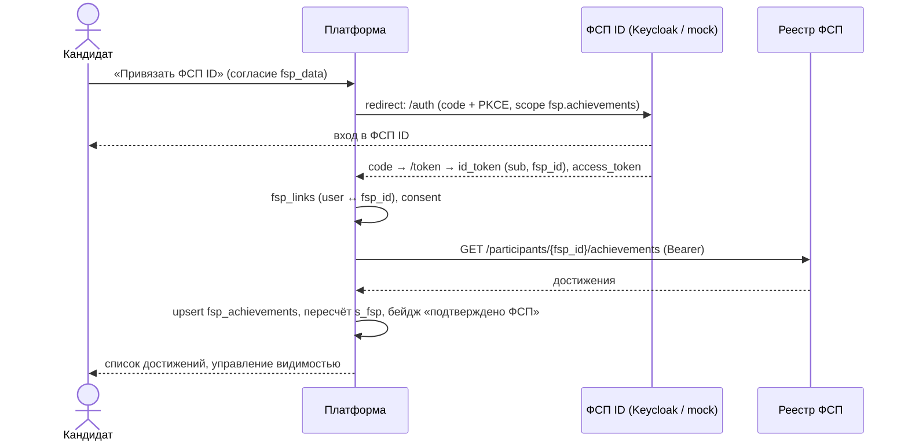

# 05. Интеграция с ФСП ID и реестром достижений

Организаторы не предоставляют API и структуру данных реестра и просят команду самой решить,
какие сведения о достижениях получать и показывать; обязательна корректная работа без истории
ФСП. Здесь — текущая реализация (mock) и целевая схема на базе Keycloak.

## 1. Что мы берём из реестра и зачем

| Поле | Зачем |
|---|---|
| `external_id` | идемпотентная синхронизация |
| `discipline` (algorithmic, product, security, robotics, uav) | релевантность специализации |
| `level` (regional, national, international) | вес достижения |
| `event_name`, `event_date` | отображение, затухание по давности |
| `result_kind` + `place` / `rank_title` / `rating` | вес результата, отображение |
| `role`, `team_name` | контекст для работодателя |

Не берём: персональные данные сверх ФИО (их даёт сам кандидат), адреса, документы.
Принцип минимизации: достижения — единственная цель интеграции.

## 2. Текущая реализация (хакатон)

`cmd/fspmock` — один процесс, два модуля:

- **OIDC-провайдер в стиле Keycloak**: `/realms/fsp/.well-known/openid-configuration`,
  `/realms/fsp/protocol/openid-connect/auth`, `/token`, `/userinfo`, `/certs` (RS256),
  Authorization Code + PKCE, scope `openid profile fsp.achievements`. Тестовые пользователи:
  участник с историей (несколько достижений), участник без истории, участник с устаревшими
  достижениями.
- **Реестр**: `GET /registry/v1/participants/{fsp_id}` и `GET /registry/v1/participants/{fsp_id}/achievements`
  с Bearer-токеном, выданным OIDC-провайдером (проверка подписи и scope).

Платформа (`internal/infrastructure/oidc`, `internal/infrastructure/fspregistry`) реализует
интерфейсы `OIDCProvider` и `FSPRegistry`; mock и будущий реальный провайдер — две реализации
одного интерфейса, конфигурируются переменными `FSP_OIDC_ISSUER`, `FSP_OIDC_CLIENT_ID`,
`FSP_OIDC_CLIENT_SECRET`, `FSP_REGISTRY_URL`.

## 3. Потоки

Вход «через ФСП ID» (без существующего аккаунта) — тот же поток: по `sub` создаётся
пользователь-кандидат с подтверждённым e-mail из claims, далее обычный опрос и тест.

Синхронизация выполняется при каждом входе и привязке через ФСП ID: реестр вызывается с
access-токеном самого участника, поэтому платформа получает только то, на что он согласился.
Обновить достижения — повторно войти через ФСП ID. Ошибки реестра не ломают профиль:
показывается последняя успешная выборка. Фоновая синхронизация требует сервисного доступа к
реестру (client credentials) и относится к целевой схеме (раздел 5).

## 4. Кандидат без истории ФСП

- `fsp_links` отсутствует или достижений нет → `s_fsp = 0`, остальные компоненты без изменений.
- В профиле — нейтральный блок «Достижения ФСП: нет данных» с кнопкой привязки и короткой
  подсказкой о том, что даёт участие в соревнованиях.
- В карточке для работодателя блок скрыт (не «нет достижений», а просто отсутствует),
  чтобы не создавать негативного сигнала.
- В валидации проверяется, что распределение позиций кандидатов без ФСП при равных прочих
  компонентах не смещено вниз больше, чем на вклад буста.

## 5. Целевая интеграция (после хакатона)

- Keycloak ФСП: realm `fsp`, клиент `fsp-platform` (confidential, PKCE), redirect URI
  `https://<платформа>/auth/fsp/callback`, scope `fsp.achievements` с claim `fsp_id`.
- Реестр: REST с пагинацией и `ETag`/`If-None-Match`, либо webhook `achievement.created` →
  наш эндпоинт `/integrations/fsp/webhook` с подписью HMAC. Адаптер уже изолирован интерфейсом.
- Отказоустойчивость: кэш в `fsp_achievements`, ретраи с экспоненциальной паузой, circuit breaker.
- Права: кандидат видит, что именно передано, и может отвязать ФСП ID (достижения удаляются).
- Что хотели бы получить от ФСП: стабильный `external_id` события, справочник дисциплин и
  уровней, ссылку на протокол для ручной проверки работодателем.

## 6. Матрица релевантности дисциплин (v1)

| Дисциплина \ Специализация | backend | frontend | data_ml | devops | qa | security |
|---|---|---|---|---|---|---|
| algorithmic | 1.0 | 0.7 | 0.9 | 0.5 | 0.6 | 0.6 |
| product | 0.9 | 1.0 | 0.6 | 0.7 | 0.7 | 0.5 |
| security | 0.6 | 0.3 | 0.3 | 0.7 | 0.5 | 1.0 |
| robotics | 0.5 | 0.2 | 0.5 | 0.4 | 0.3 | 0.2 |
| uav | 0.4 | 0.2 | 0.6 | 0.4 | 0.3 | 0.2 |

Минимум 0.2 для любой пары: участие в соревнованиях — сигнал мотивации (ответ организаторов E08).
