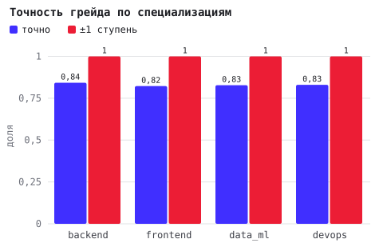
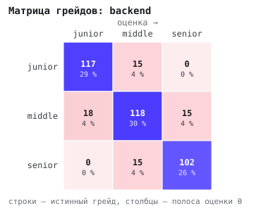
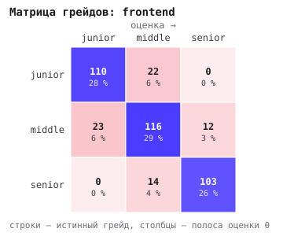
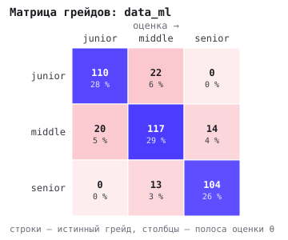
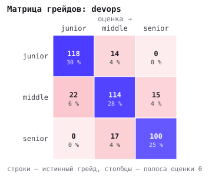
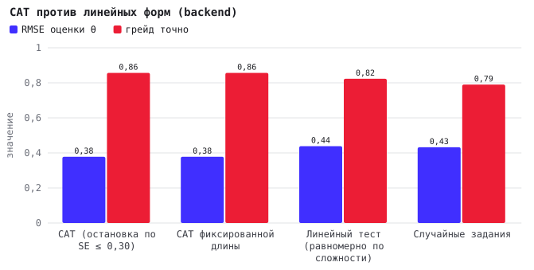
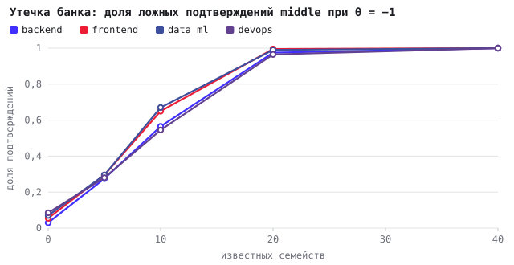
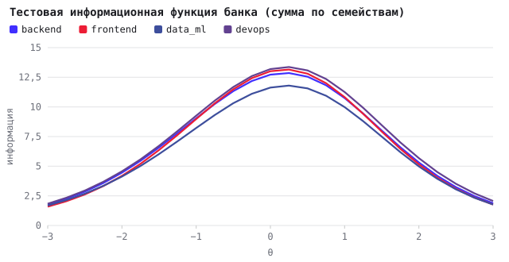
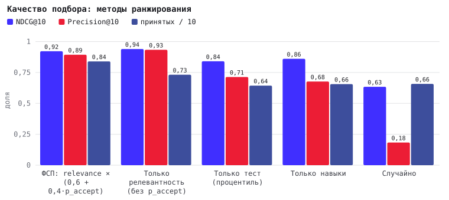

# Валидация механик «ФСП»

Сгенерировано `cmd/validate` 2026-10-11 03:59. Seed `42`, популяция 400 кандидатов на специализацию, доля завышающих заявленный грейд 30 %, семейств в банке 101. Время прогона 48s.

Воспроизвести: `task validate` (или `go run ./cmd/validate -n 400 -seed 42 -out docs/validation`). Нагрузочный раздел: `go run ./cmd/validate -load http://127.0.0.1:8080` при запущенном стенде с сидом.

## 1. Методика

Датасетов с размеченными грейдами нет (ТЗ), поэтому валидация строится на **синтетической популяции с известной истиной**: каждому кандидату назначается способность θ ~ N(0; 1,1²), истинный грейд — полоса θ (junior < −0,5 ≤ middle < 0,7 ≤ senior), и ответ на задание моделируется трёхпараметрической логистической моделью (3PL) с априорными параметрами семейства из банка. Тест проходится **тем же адаптивным движком**, что и в приложении (`pkg/irt`: EAP на сетке, выбор по информации Фишера с randomesque top-5, баланс тем, остановка SE ≤ 0,30 при ≥ 12 заданиях, максимум 20), решение по грейду — тем же правилом (P(θ ≥ границы) ≥ 0,70 для подтверждения, ≥ 0,80 для предложения повышения; для Junior граница подтверждения — минимальный уровень θ = −1,5, ниже которого верное решение — «не подтверждён»).

Проверяемые свойства и метрики:

1. **Точность** — MAE и RMSE оценки θ̂, медианная SE, длина теста, матрица грейдов (точно / ±1 ступень), корректность решения для честных и завышенных заявок.
2. **Test-retest** (PR.1) — два независимых прохождения одной и той же θ: каппа Коэна по полосам θ̂, корреляция Пирсона θ̂₁/θ̂₂, доля совпавших решений.
3. **Сравнение с базовыми методами** — CAT против линейного теста той же длины (равномерно по сложности) и случайного набора заданий.
4. **Устойчивость** — угадывающий без знаний (вероятность верного ответа по формату: 25 % для одного варианта, 8 % для нескольких, 5 % для порядка, 2 % для открытых) и **утечка банка**: атакующий с θ = −1 (junior) заявляет middle и знает верные ответы на K семейств.
5. **Дискриминативность** — тестовая информационная функция (TIF) по θ, точечно-бисериальная корреляция семейств из симуляции, список слабых семейств.
6. **Калибровка** — истинная сложность отклоняется от априорной (σ = 0,4); после накопления ответов байесовская калибровка `b` должна приближать её.
7. **Подбор** — синтетический пул, где известны истинная способность, истинные навыки и склонность к отклику; система видит θ̂ с шумом и заявленные навыки с пропусками. NDCG@10 и Precision@10 относительно скрытой полезности, ожидаемое число принятых приглашений в top-10; сравнение с базовыми ранжированиями.
8. **Нагрузка** — p50/p95/p99 ключевых операций на локальном стенде (раздел появляется при запуске с `-load`).

Ограничения: синтетика моделирует ответы по 3PL с теми же параметрами, что использует движок, — это проверяет корректность и устойчивость процедуры, но не «истинную» сложность заданий для людей; её даёт калибровка по накопленным ответам (п. 6) и экспертная разметка. Параметрические семейства генерируют уникальные экземпляры по seed, поэтому эксперимент с утечкой пессимистичен: знание семейства не равно знанию ответа конкретного экземпляра.

## 2. Точность оценки и решения по грейду

| Специализация | Семейств | MAE θ̂ | RMSE | SE медиана | Заданий | Грейд точно | ±1 ступень | Честные подтверждены | Из них «выше заявленного» | Завышенные отклонены | Ложные подтверждения | Ниже минимума Junior отклонены |
|---|---|---|---|---|---|---|---|---|---|---|---|---|
| backend | 45 | 0.29 | 0.37 | 0.38 | 20.0 | 84 % | 100 % | 79 % | 2 % | 91 % | 9 % | 83 % (n = 35) |
| frontend | 43 | 0.30 | 0.38 | 0.38 | 20.0 | 82 % | 100 % | 78 % | 2 % | 90 % | 10 % | 89 % (n = 35) |
| data_ml | 41 | 0.31 | 0.39 | 0.39 | 20.0 | 83 % | 100 % | 76 % | 2 % | 88 % | 12 % | 77 % (n = 35) |
| devops | 47 | 0.30 | 0.38 | 0.39 | 20.0 | 83 % | 100 % | 78 % | 2 % | 88 % | 12 % | 86 % (n = 35) |

Длина теста: распределение по числу заданий (все специализации) — 20: 1600.

## 3. Test-retest

| Специализация | Каппа Коэна (полосы) | r(θ̂₁, θ̂₂) | Средняя |Δθ̂| | Совпали полосы | Совпали решения |
|---|---|---|---|---|---|
| backend | 0.64 | 0.90 | 0.43 | 76 % | 76 % |
| frontend | 0.73 | 0.89 | 0.42 | 82 % | 76 % |
| data_ml | 0.64 | 0.88 | 0.45 | 76 % | 74 % |
| devops | 0.68 | 0.89 | 0.42 | 79 % | 75 % |

Каппа ≥ 0,6 — существенное согласие, ≥ 0,8 — почти полное (Landis & Koch). Несовпадения сосредоточены у границ полос: кандидат с θ ≈ −0,5 честно колеблется между junior и middle, и именно для таких случаев решение опирается на вероятность, а не на точечную оценку.

## 4. CAT против линейных форм

**backend** (длина форм 20 заданий)

| Метод | RMSE θ̂ | Грейд точно | ±1 ступень | Заданий |
|---|---|---|---|---|
| CAT (остановка по SE ≤ 0,30) | 0.38 | 86 % | 100 % | 20.0 |
| CAT фиксированной длины | 0.38 | 86 % | 100 % | 20.0 |
| Линейный тест (равномерно по сложности) | 0.44 | 82 % | 100 % | 20.0 |
| Случайные задания | 0.43 | 79 % | 100 % | 20.0 |

**frontend** (длина форм 20 заданий)

| Метод | RMSE θ̂ | Грейд точно | ±1 ступень | Заданий |
|---|---|---|---|---|
| CAT (остановка по SE ≤ 0,30) | 0.37 | 84 % | 100 % | 20.0 |
| CAT фиксированной длины | 0.37 | 84 % | 100 % | 20.0 |
| Линейный тест (равномерно по сложности) | 0.44 | 85 % | 100 % | 20.0 |
| Случайные задания | 0.46 | 84 % | 100 % | 20.0 |

**data_ml** (длина форм 20 заданий)

| Метод | RMSE θ̂ | Грейд точно | ±1 ступень | Заданий |
|---|---|---|---|---|
| CAT (остановка по SE ≤ 0,30) | 0.38 | 85 % | 100 % | 20.0 |
| CAT фиксированной длины | 0.38 | 85 % | 100 % | 20.0 |
| Линейный тест (равномерно по сложности) | 0.44 | 81 % | 100 % | 20.0 |
| Случайные задания | 0.44 | 85 % | 100 % | 20.0 |

**devops** (длина форм 20 заданий)

| Метод | RMSE θ̂ | Грейд точно | ±1 ступень | Заданий |
|---|---|---|---|---|
| CAT (остановка по SE ≤ 0,30) | 0.39 | 82 % | 100 % | 20.0 |
| CAT фиксированной длины | 0.39 | 82 % | 100 % | 20.0 |
| Линейный тест (равномерно по сложности) | 0.44 | 83 % | 100 % | 20.0 |
| Случайные задания | 0.43 | 85 % | 100 % | 20.0 |

## 5. Устойчивость: угадывание и утечка банка

| Специализация | Угадывающий подтверждён как junior | как middle | как senior | θ̂ угадывающего | Честный middle подтверждён |
|---|---|---|---|---|---|
| backend | 0 % | 0 % | 0 % | -2.54 | 88 % |
| frontend | 0 % | 0 % | 0 % | -2.44 | 89 % |
| data_ml | 0 % | 0 % | 0 % | -2.54 | 87 % |
| devops | 0 % | 0 % | 0 % | -2.50 | 90 % |

Утечка: атакующий с θ = −1,0 заявляет middle и знает ответы на K семейств (случайных, включая общие).

**backend**

| Известно семейств | Доля банка | Подтверждён как middle | Средняя θ̂ | Прирост θ̂ |
|---|---|---|---|---|
| 0 | 0 % | 3 % | -0.88 | +0.00 |
| 5 | 11 % | 28 % | -0.57 | +0.32 |
| 10 | 22 % | 56 % | -0.26 | +0.63 |
| 20 | 44 % | 98 % | 0.45 | +1.33 |
| 40 | 89 % | 100 % | 1.89 | +2.77 |

**frontend**

| Известно семейств | Доля банка | Подтверждён как middle | Средняя θ̂ | Прирост θ̂ |
|---|---|---|---|---|
| 0 | 0 % | 6 % | -0.87 | +0.00 |
| 5 | 12 % | 30 % | -0.54 | +0.33 |
| 10 | 23 % | 65 % | -0.24 | +0.63 |
| 20 | 47 % | 100 % | 0.51 | +1.38 |
| 40 | 93 % | 100 % | 2.02 | +2.89 |

**data_ml**

| Известно семейств | Доля банка | Подтверждён как middle | Средняя θ̂ | Прирост θ̂ |
|---|---|---|---|---|
| 0 | 0 % | 7 % | -0.86 | +0.00 |
| 5 | 12 % | 30 % | -0.54 | +0.32 |
| 10 | 24 % | 67 % | -0.18 | +0.68 |
| 20 | 49 % | 99 % | 0.55 | +1.42 |
| 40 | 98 % | 100 % | 2.29 | +3.16 |

**devops**

| Известно семейств | Доля банка | Подтверждён как middle | Средняя θ̂ | Прирост θ̂ |
|---|---|---|---|---|
| 0 | 0 % | 8 % | -0.82 | +0.00 |
| 5 | 11 % | 28 % | -0.55 | +0.27 |
| 10 | 21 % | 55 % | -0.28 | +0.54 |
| 20 | 43 % | 96 % | 0.43 | +1.25 |
| 40 | 85 % | 100 % | 1.77 | +2.60 |

Вывод: защита от утечки — размер банка и параметрические экземпляры (знание семейства ≠ знание ответа), контроль экспозиции (≤ 20 % сессий на семейство при достаточном банке) и мониторинг экспозиции в админке. При банке в сотни семейств утечка 5–10 из них не меняет решения; при утечке четверти банка прирост θ̂ заметен — это аргумент за расширение банка и ротацию семейств.

## 6. Дискриминативность и информативность

| Специализация | Семейств | TIF при θ = −1 | TIF при θ = 0 | TIF при θ = 1 | Минимальная SE при θ = 0 | Слабых семейств |
|---|---|---|---|---|---|---|
| backend | 45 | 9.0 | 12.7 | 10.7 | 0.28 | 5 |
| frontend | 43 | 9.0 | 13.0 | 10.8 | 0.28 | 6 |
| data_ml | 41 | 8.2 | 11.6 | 10.0 | 0.29 | 6 |
| devops | 47 | 9.3 | 13.2 | 11.3 | 0.28 | 6 |

Слабые семейства (backend): `backend.http_rest.status-codes.v1` (a=1.20, b=-0.90; максимум информации 0.22 < 0,25 (угадывание c = 0.25 съедает информативность)); `common.complexity.loop-complexity.v1` (a=1.20, b=-0.70; максимум информации 0.22 < 0,25 (угадывание c = 0.25 съедает информативность)); `common.complexity.recursion-complexity.v1` (a=1.20, b=0.20; максимум информации 0.22 < 0,25 (угадывание c = 0.25 съедает информативность)); `common.git.reset-modes.v1` (a=1.20, b=0.30; максимум информации 0.22 < 0,25 (угадывание c = 0.25 съедает информативность)); `common.http.redirect-codes.v1` (a=1.20, b=0.10; максимум информации 0.22 < 0,25 (угадывание c = 0.25 съедает информативность)).

Слабые семейства (frontend): `common.complexity.loop-complexity.v1` (a=1.20, b=-0.70; максимум информации 0.22 < 0,25 (угадывание c = 0.25 съедает информативность)); `common.complexity.recursion-complexity.v1` (a=1.20, b=0.20; максимум информации 0.22 < 0,25 (угадывание c = 0.25 съедает информативность)); `common.git.reset-modes.v1` (a=1.20, b=0.30; максимум информации 0.22 < 0,25 (угадывание c = 0.25 съедает информативность)); `common.http.redirect-codes.v1` (a=1.20, b=0.10; максимум информации 0.22 < 0,25 (угадывание c = 0.25 съедает информативность)); `frontend.accessibility.accessible-name.v1` (a=1.20, b=-0.40; максимум информации 0.22 < 0,25 (угадывание c = 0.25 съедает информативность)); `frontend.css_layout.specificity.v1` (a=1.10, b=-0.40; максимум информации 0.16 < 0,25 (угадывание c = 0.33 съедает информативность)).

Слабые семейства (data_ml): `common.complexity.loop-complexity.v1` (a=1.20, b=-0.70; максимум информации 0.22 < 0,25 (угадывание c = 0.25 съедает информативность)); `common.complexity.recursion-complexity.v1` (a=1.20, b=0.20; максимум информации 0.22 < 0,25 (угадывание c = 0.25 съедает информативность)); `common.git.reset-modes.v1` (a=1.20, b=0.30; максимум информации 0.22 < 0,25 (угадывание c = 0.25 съедает информативность)); `common.http.redirect-codes.v1` (a=1.20, b=0.10; максимум информации 0.22 < 0,25 (угадывание c = 0.25 съедает информативность)); `data_ml.metrics_validation.cv-scheme.v1` (a=1.20, b=0.00; максимум информации 0.22 < 0,25 (угадывание c = 0.25 съедает информативность)); `data_ml.statistics.z-test-conclusion.v1` (a=1.20, b=0.30; максимум информации 0.22 < 0,25 (угадывание c = 0.25 съедает информативность)).

Слабые семейства (devops): `common.complexity.loop-complexity.v1` (a=1.20, b=-0.70; максимум информации 0.22 < 0,25 (угадывание c = 0.25 съедает информативность)); `common.complexity.recursion-complexity.v1` (a=1.20, b=0.20; максимум информации 0.22 < 0,25 (угадывание c = 0.25 съедает информативность)); `common.git.reset-modes.v1` (a=1.20, b=0.30; максимум информации 0.22 < 0,25 (угадывание c = 0.25 съедает информативность)); `common.http.redirect-codes.v1` (a=1.20, b=0.10; максимум информации 0.22 < 0,25 (угадывание c = 0.25 съедает информативность)); `devops.ci_cd.cache-key.v1` (a=1.20, b=0.10; максимум информации 0.22 < 0,25 (угадывание c = 0.25 съедает информативность)); `devops.docker.port-mapping.v1` (a=1.00, b=-0.90; максимум информации 0.15 < 0,25 (угадывание c = 0.25 съедает информативность)).

Точечно-бисериальная корреляция семейств по симуляции (чем выше, тем лучше задание различает сильных и слабых); показаны 8 самых слабых и 5 самых сильных по каждой специализации с ≥ 30 выдачами:

**backend**

| Семейство | Тема | a / b / c | Выдач | Верных | r_pb |
|---|---|---|---|---|---|
| `common.git.conflict-steps.v1` | git | 1.00 / -0.50 / 0.00 | 74 | 28 % | 0.26 |
| `backend.transactions.deadlock-pair.v1` | transactions | 1.30 / 0.30 / 0.25 | 107 | 77 % | 0.26 |
| `common.networking.subnet-hosts.v1` | networking | 1.00 / -0.60 / 0.00 | 79 | 38 % | 0.28 |
| `backend.auth_security.cors-outcome.v1` | auth_security | 1.30 / 0.80 / 0.25 | 109 | 70 % | 0.33 |
| `backend.transactions.savepoint-balance.v1` | transactions | 1.10 / -0.80 / 0.00 | 140 | 45 % | 0.34 |
| `backend.transactions.isolation-anomaly.v1` | transactions | 1.30 / 0.30 / 0.25 | 91 | 79 % | 0.35 |
| `common.sql.order-limit-offset.v1` | sql | 1.10 / -0.40 / 0.00 | 202 | 40 % | 0.35 |
| `common.os_processes.fd-lowest.v1` | os_processes | 1.00 / -0.40 / 0.00 | 57 | 35 % | 0.35 |
| … | | | | | |
| `backend.transactions.isolation-visible-value.v1` | transactions | 1.30 / 0.40 / 0.00 | 303 | 52 % | 0.55 |
| `backend.errors_logging.defer-named-return.v1` | errors_logging | 1.30 / 0.20 / 0.00 | 350 | 50 % | 0.57 |
| `backend.caching.lru-misses.v1` | caching | 1.20 / 0.00 / 0.00 | 339 | 50 % | 0.58 |
| `backend.concurrency.data-race-vars.v1` | concurrency | 1.40 / 1.00 / 0.00 | 227 | 37 % | 0.58 |
| `backend.sql.group-having.v1` | sql | 1.30 / 0.10 / 0.00 | 373 | 48 % | 0.59 |

**frontend**

| Семейство | Тема | a / b / c | Выдач | Верных | r_pb |
|---|---|---|---|---|---|
| `common.git.reset-modes.v1` | git | 1.20 / 0.30 / 0.25 | 56 | 84 % | 0.13 |
| `frontend.ts_types.union-narrowing.v1` | ts_types | 1.30 / 0.20 / 0.25 | 73 | 79 % | 0.26 |
| `common.networking.subnet-hosts.v1` | networking | 1.00 / -0.60 / 0.00 | 84 | 32 % | 0.34 |
| `common.os_processes.fd-lowest.v1` | os_processes | 1.00 / -0.40 / 0.00 | 56 | 20 % | 0.35 |
| `common.data_structures.deque-ops.v1` | data_structures | 1.00 / -0.80 / 0.00 | 94 | 35 % | 0.37 |
| `frontend.css_layout.box-model-width.v1` | css_layout | 1.20 / -0.70 / 0.00 | 198 | 46 % | 0.38 |
| `common.git.conflict-steps.v1` | git | 1.00 / -0.50 / 0.00 | 73 | 34 % | 0.38 |
| `frontend.css_layout.margin-collapse.v1` | css_layout | 1.10 / -0.40 / 0.00 | 160 | 36 % | 0.39 |
| … | | | | | |
| `frontend.react_state.list-keys-input.v1` | react_state | 1.40 / 0.70 / 0.00 | 270 | 46 % | 0.56 |
| `common.sql.subquery-in.v1` | sql | 1.30 / 0.40 / 0.00 | 301 | 51 % | 0.56 |
| `common.data_structures.hash-collisions.v1` | data_structures | 1.20 / 0.10 / 0.00 | 337 | 53 % | 0.58 |
| `common.complexity.growth-order.v1` | complexity | 1.10 / 0.00 / 0.00 | 219 | 52 % | 0.58 |
| `frontend.css_layout.flex-item-width.v1` | css_layout | 1.30 / 0.00 / 0.00 | 364 | 47 % | 0.58 |

**data_ml**

| Семейство | Тема | a / b / c | Выдач | Верных | r_pb |
|---|---|---|---|---|---|
| `common.complexity.recursion-complexity.v1` | complexity | 1.20 / 0.20 / 0.25 | 50 | 82 % | 0.15 |
| `data_ml.statistics.z-test-conclusion.v1` | statistics | 1.20 / 0.30 / 0.25 | 72 | 81 % | 0.16 |
| `data_ml.statistics.variance-std.v1` | statistics | 1.00 / -0.60 / 0.00 | 87 | 32 % | 0.33 |
| `data_ml.pandas_sql.groupby-agg.v1` | pandas_sql | 1.00 / -0.90 / 0.00 | 104 | 38 % | 0.33 |
| `common.data_structures.deque-ops.v1` | data_structures | 1.00 / -0.80 / 0.00 | 104 | 35 % | 0.36 |
| `common.networking.tcp-vs-udp.v1` | networking | 1.00 / -0.70 / 0.00 | 105 | 41 % | 0.37 |
| `common.data_structures.stack-ops.v1` | data_structures | 1.00 / -1.10 / 0.00 | 103 | 49 % | 0.37 |
| `data_ml.python_core.list-slicing.v1` | python_core | 1.10 / -0.80 / 0.00 | 159 | 38 % | 0.37 |
| … | | | | | |
| `common.data_structures.binary-search-steps.v1` | data_structures | 1.30 / 0.20 / 0.00 | 366 | 49 % | 0.57 |
| `common.git.branch-commits.v1` | git | 1.20 / 0.20 / 0.00 | 338 | 48 % | 0.58 |
| `data_ml.pandas_sql.merge-rows.v1` | pandas_sql | 1.30 / 0.10 / 0.00 | 376 | 48 % | 0.58 |
| `data_ml.python_core.mutable-default.v1` | python_core | 1.40 / 0.80 / 0.00 | 261 | 44 % | 0.59 |
| `common.data_structures.hash-collisions.v1` | data_structures | 1.20 / 0.10 / 0.00 | 340 | 49 % | 0.60 |

**devops**

| Семейство | Тема | a / b / c | Выдач | Верных | r_pb |
|---|---|---|---|---|---|
| `common.os_processes.fd-lowest.v1` | os_processes | 1.00 / -0.40 / 0.00 | 64 | 36 % | 0.27 |
| `common.networking.subnet-hosts.v1` | networking | 1.00 / -0.60 / 0.00 | 100 | 31 % | 0.30 |
| `devops.networking.nat-table.v1` | networking | 1.00 / -0.60 / 0.00 | 76 | 28 % | 0.33 |
| `devops.kubernetes.probe-restart.v1` | kubernetes | 1.10 / -0.40 / 0.00 | 184 | 35 % | 0.33 |
| `common.sql.count-null.v1` | sql | 1.10 / -0.50 / 0.00 | 172 | 35 % | 0.34 |
| `devops.linux_shell.chmod-umask.v1` | linux_shell | 1.00 / -0.80 / 0.00 | 109 | 34 % | 0.35 |
| `common.data_structures.stack-ops.v1` | data_structures | 1.00 / -1.10 / 0.00 | 99 | 48 % | 0.35 |
| `common.sql.left-join-rows.v1` | sql | 1.10 / -0.60 / 0.00 | 162 | 41 % | 0.35 |
| … | | | | | |
| `devops.ci_cd.canary-traffic.v1` | ci_cd | 1.20 / 0.60 / 0.00 | 221 | 56 % | 0.55 |
| `common.data_structures.binary-search-steps.v1` | data_structures | 1.30 / 0.20 / 0.00 | 357 | 49 % | 0.56 |
| `common.git.branch-commits.v1` | git | 1.20 / 0.20 / 0.00 | 325 | 50 % | 0.56 |
| `common.sql.subquery-in.v1` | sql | 1.30 / 0.40 / 0.00 | 303 | 51 % | 0.57 |
| `common.git.conflict-steps.v1` | git | 1.00 / -0.50 / 0.00 | 75 | 28 % | 0.61 |

## 7. Калибровка сложности по накопленным ответам

| Специализация | Сессий | Семейств с ≥ 30 ответами | Медиана ответов на семейство | MAE b до калибровки | MAE b после | r(сдвиг оценённый, истинный) |
|---|---|---|---|---|---|---|
| backend | 400 | 40 | 178 | 0.22 | 0.09 | 0.89 |
| frontend | 400 | 38 | 208 | 0.24 | 0.13 | 0.87 |
| data_ml | 400 | 38 | 215 | 0.23 | 0.14 | 0.79 |
| devops | 400 | 40 | 180 | 0.25 | 0.12 | 0.89 |

Калибровка — байесовское сглаживание `b ← (κ·b_prior + n·b_emp)/(κ+n)` при κ = 20: ошибка сложности снижается уже на сотнях сессий, и это тот же код, который сервис тестирования применяет к живым ответам (параметры хранятся в `item_families`).

## 8. Качество подбора

200 синтетических кандидатов × 30 потребностей (backend, middle–senior, вилка 200–300 тыс., 4 обязательных и 2 желательных навыка).

| Метод ранжирования | NDCG@10 | Precision@10 (top-20 % по полезности) | Ожидаемо принятых из top-10 |
|---|---|---|---|
| ФСП: relevance × (0,6 + 0,4·p_accept) | 0.92 | 0.89 | 8.4 |
| Только релевантность (без p_accept) | 0.94 | 0.93 | 7.3 |
| Только тест (процентиль) | 0.84 | 0.71 | 6.4 |
| Только навыки | 0.86 | 0.68 | 6.6 |
| Случайно | 0.63 | 0.18 | 6.6 |

Полная формула (релевантность × вероятность отклика) выигрывает у одиночных сигналов и у «только релевантности» по ожидаемому числу принятых приглашений — ради этого и введён второй множитель: работодателю важно не абстрактное качество, а ответившие кандидаты.

## 9. Нагрузка

50 параллельных пользователей, 15s, стенд `http://127.0.0.1:8080`. Генератор нагрузки работает на той же машине, что API и база. Всего запросов 17434, ошибок (транспортные и любые ответы не 2xx) 0, 1162 запросов/с.

| Операция | Запросов | Ошибок | p50 | p95 | p99 | max |
|---|---|---|---|---|---|---|
| GET /healthz | 2480 | 0 | 6ms | 31ms | 42ms | 72ms |
| GET /api/v1/vacancies | 2487 | 0 | 24ms | 46ms | 71ms | 564ms |
| GET /api/v1/refdata | 2490 | 0 | 10ms | 36ms | 51ms | 272ms |
| GET /employer/needs | 2496 | 0 | 33ms | 60ms | 110ms | 588ms |
| GET /employer/needs/{id}/map | 2497 | 0 | 52ms | 87ms | 129ms | 468ms |
| GET /employer/needs/{id}/selection | 2499 | 0 | 95ms | 139ms | 172ms | 578ms |
| GET /employer/candidates/search | 2485 | 0 | 58ms | 90ms | 114ms | 702ms |

## 10. Выводы и слабые места

- Грейд определяется точно в среднем в 83 % случаев и с точностью до ступени в 100 %; test-retest каппа в среднем 0.67. Ошибки концентрируются у границ полос, что ожидаемо для непрерывной способности и дискретных грейдов.
- Угадывание без знаний не даёт подтверждения ни одного грейда; утечка части банка повышает θ̂, поэтому план — рост банка до 150+ семейств, ротация и контроль экспозиции.
- При текущем размере банка правило остановки SE ≤ 0,30 практически не срабатывает: тест идёт до максимума в 20 заданий, медианная SE ≈ 0.39. Выигрыш CAT — в точности при той же длине: RMSE θ̂ 0.38 против 0.44 у линейного теста и 0.44 у случайного набора. Чтобы остановка по SE заработала, нужны более дискриминативные семейства (a ≥ 1,5) и рост банка — зафиксировано как задача следующей итерации.
- Слабые семейства из раздела 6 — кандидаты на переработку (повысить дискриминативность или заменить).
- Подбор: двусторонний скоринг даёт больше принятых приглашений при сравнимом качестве по релевантности.
- Что не покрыто синтетикой: истинная сложность заданий для людей и экспертная разметка грейдов — закрываются накоплением живых ответов (калибровка) и консультацией с экспертами ФСП; юзабилити-прогон с людьми — отдельная процедура (чек-лист в `docs/validation/USABILITY.md`).
